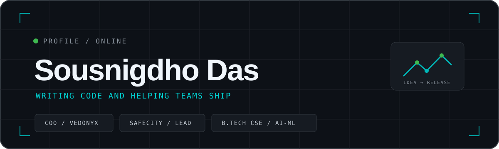
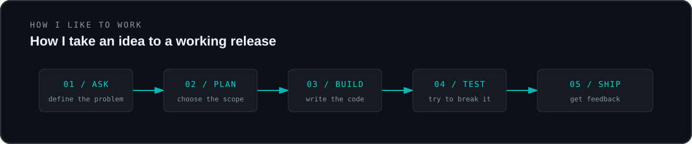

## About

I like taking an idea far enough that someone can use it. That usually means writing code, making product decisions, and helping the team get unstuck.

I'm the **Chief Operating Officer at Vedonyx**, lead **SafeCity** with [StackOverHack](https://www.linkedin.com/company/stackoverhack/), and study **B.Tech CSE (AI/ML) at Newton School of Technology**. The projects below are the ones I point people to first.

## Find me online

## What I'm doing now

| Area | What I am doing |
| --- | --- |
| Building | Leading SafeCity, a phone-based safety prototype |
| At work | Helping Vedonyx decide what to build and get it shipped |
| Studying | B.Tech CSE (AI/ML) at Newton School of Technology |
| Curious about | On-device AI, privacy, and useful public-interest software |

## Selected work

| Project | What it does | My part |
| --- | --- | --- |
| [SafeCity](https://github.com/LiteralKrishu/SafeCity) · [Site](https://safe-city-one.vercel.app/) | Phone-based safety prototype that uses sound, motion, and other cues to flag possible distress. | Team lead; architecture, backend, and development |
| [TransparAI](https://github.com/LiteralKrishu/TransparAI) | Streamlit dashboard that flags unusual patterns in public procurement data for people to review. | Built with StackOverHack for the SFLC.in hackathon |
| [SAATHI frontend](https://github.com/LiteralKrishu/saathi) | React screens for case intake and coordination, connected to the Django API. | Frontend and API integration with StackOverHack |
| [SAATHI backend](https://github.com/LiteralKrishu/saathi-backend) | Django API behind SAATHI, with role checks and documented endpoints. | Backend and API work with StackOverHack |
| [NykaaCopilot](https://github.com/LiteralKrishu/NykaaCopilot) | Matches colors from a makeup photo to a sample catalog and previews them in a 2D try-on. | Built the Next.js demo and its analysis and try-on flow |
| [Wobble](https://github.com/LiteralKrishu/Wobble) | Python CLI that finds pytest failures caused by test order and checks proposed fixes. | Built the test hunt, Docker runner, and repair flow with StackOverHack |

## Working stack

| Area | Tools |
| --- | --- |
| Product and mobile | Next.js, React, Node.js, Expo, React Native |
| AI and data | TensorFlow Lite, scikit-learn, Streamlit, Pandas, NumPy |
| Languages | TypeScript, JavaScript, Python, SQL |
| Delivery and design | Git, GitHub, Vercel, Figma |

## Highlights

- **Hacktoberfest 2026 Hack Day, NST–ADYPU:** StackOverHack won with [Wobble](https://github.com/LiteralKrishu/Wobble) at the [Pune Hack Day](https://events.mlh.com/events/15121-hacktoberfest-hack-day-pune-x-nst-adypu-powered-by-nstsdc).
- **Team Lead, SafeCity:** named as StackOverHack's team leader in the [2nd SmallAI Hackathon programme](https://smallai2026.thescrs.org/2nd-smallai-hackathon-program-schedule/).
- **Third Prize, TIH–IIT Mandi:** SafeCity's corresponding team finished third in the [Multimodal AI Hackathon](https://www.linkedin.com/posts/ihubiitmandi_multimodalai-hackathon-iitmandi-activity-7406989681428656128-irXj).
- **Third Place, SFLC.in Hackathon 2025:** StackOverHack placed third in SFLC.in's [open-source hackathon](https://sflc.in/sflc-in-hackathon-2025-celebrating-open-collaboration-and-digital-freedom/).

## Contribution activity

<a href="https://github.com/LiteralKrishu?tab=overview">
  <picture>
    <source media="(prefers-color-scheme: dark)" srcset="https://ghchart.xqsit94.in/dark:00b8b8/LiteralKrishu" />
    
  </picture>
</a>

If something here connects with what you're working on, send me a message.

