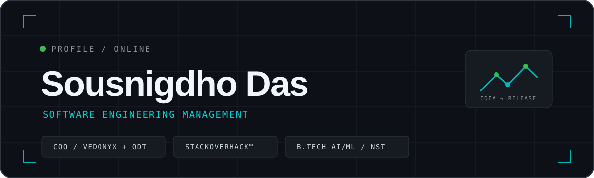
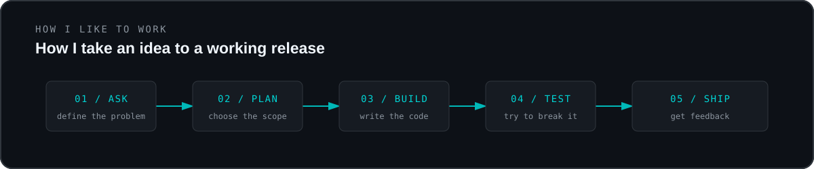

## About

I am Sousnigdho Das. Pursuing B.Tech in CSE (AI/ML) at Newton School of Technology (NST). Working as Chief Operating Officer at Vedonyx & ODT, I plan multi-stage software projects and coordinate cross-functional teams.

Guiding software architecture across the full project lifecycle. I help teams keep technical decisions aligned with long-term roadmaps and turn algorithmic research into practical, production-ready systems. I also build with [StackOverHack™](https://github.com/StackOverHack-Hub).

**Software engineering management** | **B.Tech in CSE (AI/ML) at Newton School of Technology** · **StackOverHack™** | **COO at Vedonyx and ODT**

### Open for collaboration

I am open to working with teams and individuals to plan, build, and deliver projects from research through production. [Get in touch](mailto:sousnigdhodas@gmail.com).

## Find me online

## What I'm doing now

| Area | What I am doing |
| --- | --- |
| Architecture | Guiding multi-stage software projects and cross-functional teams |
| At work | Chief Operating Officer at Vedonyx and ODT |
| Building | Working with StackOverHack™ on practical software projects |
| Studying | B.Tech in CSE (AI/ML) at Newton School of Technology |
| Curious about | On-device AI, privacy, and useful public-interest software |

## Selected work

| Project | What it does | My part |
| --- | --- | --- |
| [SafeCity](https://github.com/StackOverHack-Hub/SafeCity) · [Site](https://safe-city-one.vercel.app/) | Phone-based safety prototype that uses sound, motion, and other cues to flag possible distress. | Team lead; architecture, backend, and development |
| [TransparAI](https://github.com/StackOverHack-Hub/TransparAI) | Streamlit dashboard that flags unusual patterns in public procurement data for people to review. | Built with StackOverHack for the SFLC.in hackathon |
| [AgentExtension](https://github.com/StackOverHack-Hub/AgentExtension) | VS Code coding agent built on TrueForge, with inline edits and hunk-by-hunk review. | Built with StackOverHack |
| [ScopeCheck](https://github.com/StackOverHack-Hub/ScopeCheck) · [Site](https://scope-check.replit.app/) | Reviews client requests against agreements and keeps the decisions and approvals together. | Built with StackOverHack |
| [NammaSpace](https://github.com/LiteralKrishu/NammaSpace) · [Demo](https://nammaspace-brown.vercel.app/) | Explore a scanned classroom in 3D and find walking routes between rooms on the floor map. | Developed for IIT Bombay Techfest 2026–27 |
| [NykaaCopilot](https://github.com/LiteralKrishu/NykaaCopilot) | Matches colors from a makeup photo to a sample catalog and previews them in a 2D try-on. | Built the Next.js demo and its analysis and try-on flow |
| [Wobble](https://github.com/LiteralKrishu/Wobble) | Python CLI that finds pytest failures caused by test order and checks proposed fixes. | Built the test hunt, Docker runner, and repair flow with StackOverHack |

## Working stack

| Area | Tools |
| --- | --- |
| Product and mobile | Next.js, React, Node.js, Expo, React Native |
| AI and data | TensorFlow Lite, scikit-learn, Streamlit, Pandas, NumPy |
| Languages | TypeScript, JavaScript, Python, SQL |
| Delivery and design | Git, GitHub, Vercel, Figma |

## Highlights

- **Hacktoberfest 2026 Hack Day, NST–ADYPU:** StackOverHack won with [Wobble](https://github.com/LiteralKrishu/Wobble) at the [Pune Hack Day](https://events.mlh.com/events/15121-hacktoberfest-hack-day-pune-x-nst-adypu-powered-by-nstsdc).
- **Team Lead, SafeCity:** named as StackOverHack's team leader in the [2nd SmallAI Hackathon programme](https://smallai2026.thescrs.org/2nd-smallai-hackathon-program-schedule/).
- **Third Prize, TIH–IIT Mandi:** SafeCity's corresponding team finished third in the [Multimodal AI Hackathon](https://www.linkedin.com/posts/ihubiitmandi_multimodalai-hackathon-iitmandi-activity-7406989681428656128-irXj).
- **Third Place, SFLC.in Hackathon 2025:** StackOverHack placed third in SFLC.in's [open-source hackathon](https://sflc.in/sflc-in-hackathon-2025-celebrating-open-collaboration-and-digital-freedom/).

## Contribution activity

<a href="https://github.com/LiteralKrishu?tab=overview">
  <picture>
    <source media="(prefers-color-scheme: dark)" srcset="https://ghchart.xqsit94.in/dark:00b8b8/LiteralKrishu" />
    
  </picture>
</a>

If something here connects with what you're working on, send me a message.

